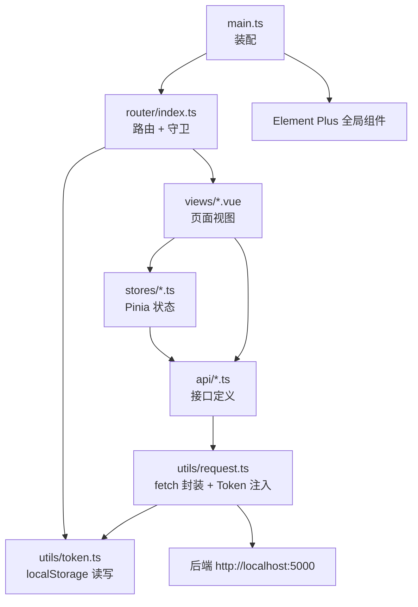

# 测试工具平台（TestPlantform）项目分析文档

> 生成时间：2026-10-11
> 分析范围：`D:\hwk\project\vue\TestPlantform` 全量源码与配置（不含 `node_modules`）

---

## 1. 项目概览

这是一个基于 **Vue 3 + TypeScript + Vite** 的纯前端单页应用（SPA），配合一个运行在
`http://127.0.0.1:5000` 的后端（从接口形态看是 Flask 之类的轻量服务，代码不在本仓库内）。

应用当前提供三类能力：

| 能力 | 入口 | 说明 |
| --- | --- | --- |
| 登录鉴权 | `/login` | 账号密码登录，拿到 token 存 localStorage |
| 设备管理 | `/device-manage`、`/device-edit/:id` | 设备列表查询、分页、编辑、查看、删除 |
| 格式转换 | `/format-convert` | JSON 报文转树状图，支持字段搜索与定位 |

### 技术栈

| 类别 | 选型 | 版本 | 说明 |
| --- | --- | --- | --- |
| 框架 | Vue | ^3.5.40 | 全部使用 `<script setup>` 组合式 API |
| 语言 | TypeScript | ~6.0.0 | `vue-tsc` 做类型检查 |
| 构建 | Vite | ^8.1.5 | 开发服务器 5173 端口 |
| 路由 | vue-router | ^5.2.0 | History 模式 + 全局前置守卫 |
| 状态 | Pinia | ^4.0.2 | Setup Store 写法（用 `ref/computed` 定义） |
| UI | Element Plus | ^2.14.4 | 全量注册 + 中文语言包 |
| 网络 | 原生 `fetch` | — | 未使用 axios，自己封装了 `request` |
| 格式化 | Prettier | 3.9.5 | 无分号、单引号、100 列 |

### 常用命令

```bash
npm install        # 安装依赖
npm run dev        # 启动开发服务器（http://localhost:5173）
npm run build      # 类型检查 + 生产构建（输出到 dist/）
npm run build-only # 只构建不做类型检查
npm run type-check # 仅类型检查（vue-tsc --build）
npm run preview    # 预览 dist 构建产物
npm run format     # Prettier 格式化 src/
```

---

## 2. 目录结构

```text
TestPlantform/
├── .codex/skills/add-top-menu/     # 项目级 Codex Skill：按关键词新增一级菜单
├── .vscode/                        # 编辑器配置（格式化、推荐插件）
├── dist/                           # 构建产物（自动生成，禁止手改）
├── node_modules/                   # 依赖（自动生成）
├── public/
│   └── favicon.ico                 # 站点图标，原样拷贝到构建产物根目录
├── src/
│   ├── api/                        # 接口层：只负责“和后端说话”
│   │   ├── auth.ts
│   │   └── device.ts
│   ├── assets/                     # 需要被打包器处理的静态资源
│   │   └── login-banner2.png
│   ├── router/
│   │   └── index.ts                # 路由表 + 登录守卫
│   ├── stores/                     # Pinia 状态层
│   │   ├── auth.ts
│   │   ├── counter.ts
│   │   └── device.ts
│   ├── utils/                      # 基础设施：请求封装、token 读写
│   │   ├── request.ts
│   │   └── token.ts
│   ├── views/                      # 页面级组件（一个路由对应一个文件）
│   │   ├── DeviceEditView.vue
│   │   ├── DeviceManageView.vue
│   │   ├── FormatConvertView.vue
│   │   ├── HomeView.vue
│   │   ├── LayoutView.vue
│   │   └── LoginView.vue
│   ├── App.vue                     # 根组件：只放 <RouterView /> 和全局样式
│   └── main.ts                     # 应用入口：装配 Pinia / Router / Element Plus
├── env.d.ts                        # Vite 客户端类型声明
├── index.html                      # HTML 模板，挂载点 #app
├── package.json                    # 依赖与脚本
├── tsconfig*.json                  # TypeScript 三层配置
└── vite.config.ts                  # 别名 @ 与开发代理
```

---

## 3. 启动链路：一次页面加载都发生了什么

```text
浏览器请求 index.html
  └─ <div id="app"> + <script type="module" src="/src/main.ts">
       └─ main.ts: createApp(App) → app.use(Pinia) → app.use(Router) → app.use(ElementPlus)
            └─ App.vue: <RouterView />            ← 一切页面都渲染在这里
                 └─ router/index.ts 匹配当前 URL
                      ├─ /login        → LoginView.vue（独立全屏页）
                      └─ /            → LayoutView.vue（带侧边栏的框架页）
                           └─ <router-view /> 嵌套渲染子页面
                                ├─ device-manage   → DeviceManageView.vue
                                ├─ device-edit/:id → DeviceEditView.vue
                                └─ format-convert  → FormatConvertView.vue
```

关键点：**路由是两层嵌套的**。`LayoutView` 是父路由组件，子页面渲染在它内部的
`<router-view />` 里，所以侧边栏和顶栏在页面切换时不会重新渲染。

---

## 4. 分层架构



各层职责边界：

| 层 | 目录 | 该做什么 | 不该做什么 |
| --- | --- | --- | --- |
| 视图层 | `src/views` | 渲染、交互、表单校验、调用 store | 不直接写 URL、不直接 fetch |
| 状态层 | `src/stores` | 维护业务数据、编排接口调用、缓存列表 | 不写 DOM 逻辑 |
| 接口层 | `src/api` | 定义 URL、参数、返回类型、`code` 校验 | 不碰组件状态 |
| 基建层 | `src/utils` | 请求封装、token 存取 | 不含业务语义 |
| 路由层 | `src/router` | 路径与组件映射、访问控制 | 不写业务逻辑 |

**数据流闭环**（以设备列表为例）：

```text
DeviceManageView(onMounted)
  → deviceStore.fetchDevices(params)
    → api/device.ts getDevices()  拼 query，调 request()
      → utils/request.ts 加 Authorization 头，fetch 后端
        ← { code, msg, data:{ list, total } }
    ← store.list 赋值
  ← 因为 list 是 ref，视图自动重渲染
```

---

## 5. 逐文件详解

### 5.1 根目录文件

#### `index.html`
HTML 模板，Vite 的构建起点。`<div id="app">` 是 Vue 的挂载点，`<script type="module" src="/src/main.ts">` 加载入口模块。
`<title>测试平台</title>` 是浏览器标签页标题（注意与登录页标题「测试工具平台」不一致，见第 8 节）。

#### `src/main.ts`
应用装配入口，只做“接线”，不含业务：

```ts
const app = createApp(App)
app.use(createPinia())                        // 启用 Pinia 状态管理
app.use(router)                               // 启用路由
app.use(ElementPlus, { locale: zhCn })        // 全量注册 Element Plus 并设中文
app.mount('#app')                             // 挂载到 index.html 的 #app
```

因为这里做了 `app.use(ElementPlus)`，所有页面里都能直接用 `<el-card>`、`<el-table>` 等组件，
**不需要在每个 .vue 里 import 组件**；但图标（`@element-plus/icons-vue`）是按需 import 的。

#### `src/App.vue`
根组件，模板只有一个 `<RouterView />`，即“页面内容全部由路由决定”。
`<style>`（非 scoped）里重置了 `margin/padding`、`box-sizing`、`html/body/#app` 高度 100%，
并统一了字体族。这是全局样式，其他组件靠 `scoped` 隔离。

#### `vite.config.ts`
- `@` 别名 → `src`：让 `@/stores/auth` 这类绝对风格导入生效（`tsconfig.app.json` 里的 `paths` 必须同步配置，否则 TS 报错）。
- `server.proxy['/api']` → `http://127.0.0.1:5000`：本意是开发期跨域代理。
  ⚠️ 实际上 `utils/request.ts` 里的 `BASE_URL` 是绝对地址，请求根本没走 `/api` 相对路径，
  所以这段代理目前**不会被触发**（详见第 8 节）。

#### `env.d.ts`
`/// <reference types="vite/client" />`，为 `import.meta.env`、`*.vue` 等提供类型。

#### `tsconfig.json` / `tsconfig.app.json` / `tsconfig.node.json`
- `tsconfig.json`：只有 `references`，是“总入口”，本身不含源码。
- `tsconfig.app.json`：管 `src/**`（浏览器环境）。启用了 `noUncheckedIndexedAccess`（数组/对象下标访问会得到 `T | undefined`），并配置了 `@/*` 路径映射。
- `tsconfig.node.json`：管 `vite.config.*` 等 Node 侧配置文件，`types: ["node"]`。

#### `.prettierrc.json`
`semi: false`（不写分号）、`singleQuote: true`（单引号）、`printWidth: 100`。全项目代码风格由此决定。

#### `.vscode/settings.json`、`.vscode/extensions.json`
推荐 Volar + Prettier，保存自动格式化；`explorer.fileNesting` 只是把关联文件在侧边栏折叠显示，不影响运行。

#### `.gitignore`
忽略 `node_modules`、`dist`、`*.log`、`.vscode/*`（保留 `extensions.json`）、`*.tsbuildinfo` 等。注意 **`.codex/` 没有被忽略**，项目级 skill 会随仓库一起提交。

#### `package.json`
声明依赖与脚本。可注意两点：
- `unplugin-auto-import`、`unplugin-vue-components` 装在 `devDependencies` 里，但 `vite.config.ts` 没有配置这两个插件，属于**装了没用**。
- `build` = `run-p type-check build-only`，即类型检查和构建并行执行。

#### `dev-server.log`
一次本地 `npm run dev` 的历史输出（Vite 8.2.0，运行在 `http://localhost:5173/`）。它被 `.gitignore` 的 `*.log` 规则覆盖，属于临时文件。

---

### 5.2 `src/router/index.ts` —— 路由与访问控制

```ts
history: createWebHistory(import.meta.env.BASE_URL)   // HTML5 History 模式，无 #
```

路由表只有两条顶层记录：

| 路径 | 名称 | 组件 | meta | 说明 |
| --- | --- | --- | --- | --- |
| `/login` | `login` | LoginView | `guest: true` | 游客页，已登录用户不应再访问 |
| `/` | — | LayoutView | `requiresAuth: true` | 框架页，`redirect: '/device-manage'` |
| `└ device-manage` | `device-manage` | DeviceManageView | 继承父级 meta | 设备列表 |
| `└ device-edit/:id` | `device-edit` | DeviceEditView | 继承父级 meta | `:id` 是动态参数 |
| `└ format-convert` | `format-convert` | FormatConvertView | 继承父级 meta | JSON 格式转换 |

子路由的 `path` **不带前导斜杠**（`'device-manage'`），最终拼接为 `/device-manage`。
所有页面组件都用 `() => import(...)` 动态导入，即**路由级懒加载**：只有访问该页面才下载对应 chunk。

全局前置守卫：

```ts
router.beforeEach((to) => {
  const hasToken = !!getToken()

  if (to.meta.requiresAuth && !hasToken) {
    return { name: 'login' }        // 未登录访问受保护页面 → 打回登录页
  }
  if (to.meta.guest && hasToken) {
    return { name: 'device-manage' } // 已登录再访问 /login → 直接进首页
  }
})
```

`to.meta` 是**合并后**的 meta：访问 `/device-manage` 时会同时拿到父级的 `requiresAuth: true`，
所以子页面自动受保护，不必每个子路由重复声明。守卫没有返回值时（`undefined`）表示放行。

---

### 5.3 `src/utils/token.ts` —— 凭证的读写

```ts
const TOKEN_KEY = 'access_token'
getToken()            // localStorage.getItem，返回 string | null
setToken(token)       // 登录成功后写入
removeToken()         // 退出登录时清除
```

把 key 收敛在一个文件里，避免各处硬编码字符串。存 localStorage 意味着关闭浏览器后仍保持登录，
刷新页面也不会丢；代价是没有过期时间管理（见第 8 节）。

---

### 5.4 `src/utils/request.ts` —— 网络基建

```ts
export const BASE_URL = 'http://localhost:5000'
```

请求封装的完整逻辑：

1. 从 `token.ts` 取 token，有则加 `Authorization: Bearer <token>` 头。
2. 有 body 且没显式指定 `Content-Type` 时，自动设 `application/json`。
3. URL 以 `http` 开头就用绝对地址，否则拼上 `BASE_URL`（本项目实际都走拼接分支）。
4. `fetch` 之后先判断 `response.ok`：非 2xx 时解析响应体里的 `msg` 抛出中文错误，否则退化为 `请求失败: <状态码>`。
5. 成功时统一 `response.json()` 并泛型返回 `Promise<T>`。

这是全项目唯一的网络出口，好处是鉴权头、错误文案、基础地址只有一处；
`fetch` 不像 axios 那样自动抛错，所以这里手动做了 `!response.ok` 判断。

---

### 5.5 `src/api/` —— 接口契约

#### `src/api/auth.ts`

```ts
export interface LoginParams { username: string; password: string }
export interface LoginResult { token: string; username: string }
export async function login(params): Promise<LoginResult>
```

后端返回统一信封 `{ code, msg, data }`。这里把「HTTP 成功」和「业务成功」分开判断：
只有 `code === 200 && data.token` 才返回结果，否则 `throw new Error(res.msg)`。
`username` 取不到时兜底用传入的用户名，保证 UI 上一定有值可显示。

#### `src/api/device.ts`

定义了核心业务模型：

```ts
export interface Device {
  id: number
  name: string                                   // 姓名（使用人）
  platform: '安卓' | '苹果' | '鸿蒙'              // 机型，字面量联合类型
  model: string                                  // 手机型号
  enabled: boolean                               // 启用状态
}
```

`platform` 用**字符串字面量联合类型**而不是 `string`，能在编译期挡住非法值。
提供 5 个方法，全部返回 `Promise` 并校验 `code`：

| 函数 | 方法 | 路径 | 返回 |
| --- | --- | --- | --- |
| `getDevices(params)` | GET | `/api/devices?name=&platform=` | `{ list, total }` |
| `getDevice(id)` | GET | `/api/devices/{id}` | `Device` |
| `createDevice(data)` | POST | `/api/devices` | 新 `id` |
| `updateDevice(id, data)` | PUT | `/api/devices/{id}` | `void` |
| `deleteDevice(id)` | DELETE | `/api/devices/{id}` | `void` |

查询串用 `URLSearchParams` 构造，空值自动跳过，避免手拼字符串出错。
`getDevices` 在 `data` 缺失时兜底为 `{ list: [], total: 0 }`，保证调用方不会拿到 `undefined`。

---

### 5.6 `src/stores/` —— 状态管理

#### `src/stores/auth.ts`

```ts
export const useAuthStore = defineStore('auth', () => { ... })
```

采用 **Setup Store**：函数体就是 `setup()`，`ref` 即 state，`computed` 即 getter，函数即 action。

- `token`、`username` 两个 ref。
- `login()`：调 `loginApi` → 写入内存状态 → `setToken()` 落盘。**顺序是先内存后持久化**。
- `logout()`：清空两者并 `removeToken()`。

副作用点：只有 token 持久化了，`username` 没有。所以刷新页面后顶栏用户名会变空（见第 8 节）。

#### `src/stores/device.ts`

设备数据的中枢，持有 `list: Device[]` 和 `loading: boolean`。

| 成员 | 类型 | 作用 |
| --- | --- | --- |
| `list` | `ref<Device[]>` | 当前展示的数据源 |
| `loading` | `ref<boolean>` | 供 `v-loading` 使用 |
| `total` | `computed` | 注意：是 `list.length`，不是后端 `total` |
| `fetchDevices` | action | 拉列表，`try/finally` 保证 loading 复位 |
| `fetchDevice` | action | 拉单个并**写回 list 对应项**；内部 `catch` 后返回 `undefined` |
| `getDeviceById` | 同步方法 | 从本地 list 查找 |
| `updateDevice` | action | 调接口成功后就地合并本地对象 |
| `deleteDevice` | action | 调接口成功后从本地 list 过滤掉 |

这里体现了一个明确的取舍：**本地先行更新（乐观/补偿式）而非重新拉全量**，减少一次网络往返。
`fetchDevice` 把异常吞掉换成 `undefined`，让编辑页用 `notFound` 展示「设备不存在」，但也会掩盖真实网络错误。

#### `src/stores/counter.ts`
Pinia 官方脚手架示例（`count` / `doubleCount` / `increment`）。全项目没有任何地方 import 它，
属于**模板残留的死代码**。

---

### 5.7 `src/views/` —— 页面组件

#### `src/views/LoginView.vue`（`/login`）

左右分栏布局：左侧 `login-banner2.png` 背景图，右侧登录卡片。移动端（`max-width: 768px`）隐藏左侧图。

脚本部分：

```ts
const formRef = ref<FormInstance>()
const form = reactive({ username: '', password: '' })
const rules: FormRules = { ... }   // Element Plus 表单校验规则
```

`handleLogin()` 的执行顺序：`formRef.validate()` 校验 → `catch(() => false)` 把校验失败转成 `false` 提前返回
→ `loading = true` → `authStore.login()` → 成功提示并 `router.push('/device-manage')`
→ 失败按 `Error.message` 提示 → `finally` 复位 loading。
两个输入框都绑了 `@keyup.enter="handleLogin"`，回车即登录。

样式上卡片圆角 16px、紫色主色（通过 CSS 变量覆盖 `--el-color-primary` 系列，让 Element Plus 组件跟随紫色），
标题下方用 `::after` 画了一条渐变装饰线。底部版权文字用绝对定位贴底并设了 `pointer-events: none`。
演示账号提示 `<p class="hint">` 目前是注释状态，`.hint` 样式仍在。

#### `src/views/LayoutView.vue`（框架页）

登录后所有页面的外壳，负责四件事：

1. **左侧菜单**：`<el-menu router>` 开启路由模式，`el-menu-item` 的 `index` 直接写路径，
   点击即跳转，无需手写 click 事件。当前有两个一级菜单：
   - 「基础管理」（index `basic`，图标 `Grid`）→ 子项「设备管理」`/device-manage`
   - 「格式转换」（index `format`，图标 `Switch`）→ 子项「JSON」「XMind」（都指向 `/format-convert`）
2. **菜单高亮**：

   ```ts
   const activeMenu = computed(() =>
     route.path.startsWith('/device') ? '/device-manage' : route.path,
   )
   ```
   因为 `/device-edit/:id` 不在菜单项里，这里用前缀匹配把它**归一化**到 `/device-manage`，保证编辑页仍高亮父菜单。

3. **面包屑**：

   ```ts
   const breadcrumbs = computed<Breadcrumb[]>(() => {
     const isReadonly = route.query.readonly === '1'
     if (route.path.startsWith('/device')) {
       const crumbs = [{ label: '基础管理' }, { label: '设备管理', path: '/device-manage' }]
       if (route.path.startsWith('/device-edit/')) {
         crumbs.push({ label: isReadonly ? '查看设备' : '编辑设备' })
       }
       return crumbs
     }
     if (route.path.startsWith('/format-convert')) {
       return [{ label: '格式转换' }, { label: 'JSON' }]
     }
     return [{ label: '基础管理' }]
   })
   ```
   面包屑是**硬编码分支**：按路径前缀拼数组，最后一项不给 `path` 就渲染成纯文本，前面的项用 `<router-link>` 可点。
   只读与编辑的标题差异来自 URL 上的 `?readonly=1`。

4. **用户区与退出**：右上角下拉菜单只有一个「退出登录」，点击后 `ElMessageBox.confirm` 二次确认，
   确认则 `authStore.logout()` 并 `router.push('/login')`，取消走 `.catch(() => {})` 静默处理。

布局用 `<el-container>/<el-aside width="220px">/<el-header>` 实现，侧边栏固定 220px，
`<el-main>` 用浅灰底 `#f0f2f5` 承载内容页。

#### `src/views/DeviceManageView.vue`（`/device-manage`）

设备列表页，结构是「筛选卡片 + 表格卡片」。

- **筛选**：`filterName`、`filterPlatform` 两个 ref，查询/重置按钮；重置会把页码归 1 并重新请求。
  两个操作都使用 `:icon="Search"` / `:icon="Refresh"` 直接绑定图标组件。
- **数据获取**：`onMounted(fetchData)` 首次加载；`fetchData` 里 `try/catch` 弹出中文错误提示。
  注意它把空字符串转成 `undefined`（`filterName.trim() || undefined`），避免把空条件发给后端。
- **分页**：`pagedList` 是 `computed`，对 `deviceStore.list` 做 `slice`——**前端分页**。
  `indexMethod` 让序号跨页连续：`(currentPage - 1) * pageSize + index + 1`。
- **表格渲染**：`platform` 用 `<el-tag>` 按机型映射不同颜色（`platformTagType`），
  `enabled` 用 success/info 标签显示「启用/禁用」，`#empty` 插槽自定义空数据为 `<el-empty>`。
- **行操作**：编辑跳 `/device-edit/:id`，查看跳 `/device-edit/:id?readonly=1`（同一个组件两种模式），
  删除先 `ElMessageBox.confirm` 二次确认，再调 store 并提示。

#### `src/views/DeviceEditView.vue`（`/device-edit/:id`）

编辑与查看共用同一组件，靠 query 参数切模式：

```ts
const deviceId = Number(route.params.id)          // 路由参数是字符串，转成数字
const isReadonly = route.query.readonly === '1'   // 只读开关
const notFound = computed(() => !loading.value && !device.value)
```

- `onMounted` 里 `deviceStore.fetchDevice(deviceId)`，成功后把结果灌入 `form`。
- `notFound` 为真时渲染 `<el-result icon="warning" title="设备不存在">` 并提供「返回列表」。
- 表单用 `:disabled="isReadonly"` 一次性禁用所有字段；保存按钮用 `v-if="!isReadonly"` 隐藏。
- `handleSave` 先 `validate()`（用 `try/catch` 而非 `.catch`），再 `deviceStore.updateDevice(deviceId, { ...form })`，
  成功后提示并跳回列表。
- 机型下拉的 `form.platform` 用 `'安卓' as '安卓' | '苹果' | '鸿蒙'` 收窄类型，与 `Device.platform` 保持一致。

#### `src/views/FormatConvertView.vue`（`/format-convert`）

纯前端工具页：左侧粘贴 JSON，中间转换，右侧 `el-tree` 展示。核心逻辑全部在脚本里：

| 函数 | 作用 |
| --- | --- |
| `buildTree(key, value)` | 递归把任意 JSON 值转成 `TreeNode`。null / 字符串 / 基本类型 / 数组 / 对象分五种情况处理，数组下标键渲染成 `[0]`，对象键渲染成 `key: value`；每个节点用自增 `uid` 生成唯一 `id` |
| `handleConvert` | `JSON.parse` 成功则建树并重置搜索状态，失败弹「JSON 格式错误」并清空结果 |
| `handleClear` | 清空输入与结果 |
| `handleNodeClick` | 从被点节点向上遍历 `parent`，把各级 `key` 拼成 `a.b[0].c` 形式的路径，数组下标不加点 |
| `refreshMatches` | 深度遍历树收集 label 命中关键字的节点 id，`watch(filterText, ...)` 触发 |
| `prevMatch` / `nextMatch` | 用取模实现循环切换命中项 |
| `scrollToMatch` | `await nextTick()` 两次确保 DOM 更新后，用 `querySelector('[data-match-id="..."]')` 找到节点并 `scrollIntoView` |
| `renderNode` | 自定义渲染函数：把命中的关键字包成 `<mark class="hl">`，当前项额外加 `.match-current` 类 |
| `expandAll` / `collapseAll` | 通过 `treeRef.value.store.nodesMap` 批量设置 `expanded` |
| `onKeydown` | 拦截 `Ctrl/Cmd + F`，阻止浏览器默认查找，聚焦到右侧搜索框 |

几个值得留意的实现细节：

- `<el-tree :key="treeVersion">`：搜索时自增 `treeVersion` 强制重建树，否则 `render-content` 的高亮不会刷新。
- `escapeRegExp()` 在构造正则前转义特殊字符，避免用户输入 `(`、`*` 时正则报错。
- `onMounted` 注册 `keydown` 监听，`onBeforeUnmount` 移除，避免内存泄漏（单页应用尤其要注意）。
- 样式里对 `.el-textarea__inner`、`.el-tree-node__label` 都用了 `:deep()`，因为 scoped 样式默认作用不到子组件内部。

#### `src/views/HomeView.vue`
一个「欢迎 + 显示 Token + 退出登录」的示例页。**当前没有任何路由指向它**，属于历史遗留页面（死代码）。
其退出逻辑与 `LayoutView` 重复。

---

### 5.8 其他

| 文件 | 说明 |
| --- | --- |
| `src/assets/login-banner2.png` | 登录页左侧背景图，由 Vite 处理并输出带 hash 的文件名 |
| `public/favicon.ico` | 站点图标，不经打包处理，原样复制到构建输出根目录 |
| `dist/` | 上一次 `npm run build` 的产物，**已被 `src` 的后续修改甩开**（例如里面仍是「测试平台」），仅供预览，不要手改 |
| `dev-server.log` | 本地开发服务器日志，临时文件 |
| `.codex/skills/add-top-menu/` | 项目级 Codex Skill，用于「给一个关键词就自动新增一级菜单」，含 `SKILL.md`、`references/element-plus-admin.md`、`agents/openai.yaml` |

---

## 6. 关键机制专题

### 6.1 认证闭环

```text
① 输入账号密码 → LoginView.handleLogin
② authStore.login → api/auth.login → POST /api/login
③ 后端返回 { code:200, data:{ token, username } }
④ setToken(token) 写入 localStorage['access_token']
⑤ router.push('/device-manage')
⑥ 后续每次请求：request.ts 从 localStorage 取 token → Authorization: Bearer <token>
⑦ 进入受保护路由前：router.beforeEach 检查 token，没有就打回 /login
⑧ 退出登录：authStore.logout() 清状态 + 清 localStorage → 回登录页
```

没有 refresh token、没有过期时间校验、没有 401 自动跳转，属于**最小可用**的鉴权实现。

### 6.2 两套「后端地址」的重复

| 位置 | 值 | 是否生效 |
| --- | --- | --- |
| `vite.config.ts` 的 `server.proxy['/api']` | `http://127.0.0.1:5000` | ❌ 不生效（请求没走相对路径） |
| `utils/request.ts` 的 `BASE_URL` | `http://localhost:5000` | ✅ 生效 |

因为 `request()` 会把 `/api/devices` 拼成 `http://localhost:5000/api/devices`，浏览器直接发跨域请求，
Vite 代理被绕过。开发时依赖后端开启 CORS。建议只保留一处：要么全用相对路径 + 代理，要么明确写死绝对地址。

### 6.3 接口契约

所有接口返回统一信封：

```json
{ "code": 200, "msg": "ok", "data": { } }
```

`code !== 200` 时，api 层抛出 `msg` 作为错误消息，视图层用 `ElMessage.error(err.message)` 展示。
HTTP 层面非 2xx 由 `request.ts` 统一处理。

| 接口 | 方法 | 参数 |
| --- | --- | --- |
| `/api/login` | POST | `{ username, password }` |
| `/api/devices` | GET | `?name=&platform=` |
| `/api/devices` | POST | `Omit<Device,'id'>` |
| `/api/devices/{id}` | GET / PUT / DELETE | — |

### 6.4 代码约定

- **命名**：页面组件 `XxxView.vue`（PascalCase + View 后缀）；路由 `name` 用 kebab-case 与路径同名；
  store 统一 `useXxxStore`；api 函数用动词开头（`get/create/update/delete`）。
- **导入**：跨目录一律用 `@/` 别名；Element Plus 组件全局可用，只有 **图标需要显式 import**。
- **样式**：`<style scoped>`，穿透子组件用 `:deep()`；颜色多为硬编码色值（`#409eff`、`#303133` 等）。
- **格式**：Prettier 无分号、单引号、100 列，保存即格式化。
- **类型**：业务模型集中在 `api/*.ts` 导出，store 只做 `import type` 中转，视图再从中引用。

---

## 7. 路由 / 状态 / 接口速查

### 路由表

| 路径 | 组件 | 鉴权 | 说明 |
| --- | --- | --- | --- |
| `/login` | LoginView | 游客 | 已登录会跳走 |
| `/` | LayoutView | 需登录 | 重定向到 `/device-manage` |
| `/device-manage` | DeviceManageView | 需登录 | 设备列表 |
| `/device-edit/:id` | DeviceEditView | 需登录 | `?readonly=1` 为查看模式 |
| `/format-convert` | FormatConvertView | 需登录 | JSON 转树 |

### Pinia Store

| Store | 状态 | 动作 |
| --- | --- | --- |
| `auth` | `token`、`username` | `login`、`logout` |
| `device` | `list`、`loading`、`total`(计算) | `fetchDevices`、`fetchDevice`、`getDeviceById`、`updateDevice`、`deleteDevice` |
| `counter` | `count`、`doubleCount` | `increment`（未使用） |

---

## 8. 现存问题与改进建议

按影响程度从高到低：

1. **品牌名不统一**：`index.html` 的 `<title>`、`LayoutView` 侧边栏 logo、`README.md` 仍是「测试平台」，
   而 `LoginView` 标题已改为「测试工具平台」。建议统一为「测试工具平台」，并同步 `index.html`。
2. **后端地址重复且代理失效**：见 6.2。建议 `request.ts` 改为相对路径 `/api`，统一交给 Vite 代理，
   生产环境再用环境变量（`import.meta.env.VITE_API_BASE`）覆盖。
3. **登录态不完整**：`username` 未持久化，刷新顶栏就空了。可把用户名一并写入 localStorage，
   或增加 `GET /api/me` 在应用启动时恢复用户信息。
4. **缺少 401 处理**：token 过期/失效时接口返回 401，目前只在页面上弹一个错误，不会自动回到登录页。
   建议在 `request.ts` 里统一拦截 401 → `removeToken()` + 跳转 `/login`。
5. **分页语义混乱**：`el-pagination` 的 `total` 用的是 `deviceStore.list.length`（前端分页），
   但接口返回了 `total` 字段却被丢弃。数据量大时应改成后端分页。
6. **死代码**：`src/views/HomeView.vue`、`src/stores/counter.ts` 无人引用，可删除。
   同时 `devDependencies` 里的 `unplugin-auto-import` / `unplugin-vue-components` 未在 Vite 中启用。
7. **异常被吞**：`device.ts` 的 `fetchDevice` 用 `catch { return undefined }` 把网络错误和设备不存在混为一谈，
   建议区分「404 不存在」与「请求失败」。
8. **只能编辑不能新增**：`api/device.ts` 已有 `createDevice`，但没有任何页面调用它，
   列表页也缺少「新增」按钮。补一个 `/device-edit/new` 或独立新增页即可闭环 CRUD。
9. **重复的退出逻辑**：`LayoutView` 与 `HomeView` 各写了一份确认框 + logout 流程，可抽成 composable。
10. **缺乏工程保障**：没有 ESLint、单元测试和 CI；`tsconfig.app.json` 已开启 `noUncheckedIndexedAccess`，
    新增代码要注意下标访问可能返回 `undefined`。
11. **`dist/` 与源码不同步**：仓库里的构建产物仍是旧文案，容易被误当成现状，建议构建后再提交或直接忽略。

---

## 9. 如何在本项目里加功能

### 新增一个一级菜单（已有自动化 Skill）

本项目内已放置 `.codex/skills/add-top-menu/`，会给关键词自动完成「页面 + 路由 + 侧边栏 + 面包屑」四处改动。
手工操作时需要同步修改：

1. 新建 `src/views/XxxView.vue`（参考 `DeviceManageView.vue` 的结构）。
2. `src/router/index.ts` 的 `children` 里加一条懒加载路由。
3. `src/views/LayoutView.vue` 加 `<el-sub-menu>`（含未使用的 `@element-plus/icons-vue` 图标）。
4. 同文件的 `breadcrumbs` 计算属性里加一个路径前缀分支。

### 新增一个接口

1. 在 `src/api/xxx.ts` 定义入参、返回类型和后端信封类型。
2. 用 `request<T>('/api/xxx', { method, body: JSON.stringify(...) })` 调用，并校验 `res.code`。
3. 在对应的 `src/stores/xxx.ts` 里包一层 action，维护 `loading` 与本地数据。
4. 视图只调用 store 的 action，`try/catch` 后用 `ElMessage` 提示。

---

## 10. 附录：文件功能总表

| 文件 | 类型 | 核心职责 |
| --- | --- | --- |
| `index.html` | 模板 | HTML 骨架、挂载点、页面标题 |
| `src/main.ts` | 入口 | 创建应用、装配 Pinia / Router / Element Plus |
| `src/App.vue` | 根组件 | `<RouterView />` + 全局样式重置 |
| `src/router/index.ts` | 路由 | 路由表、懒加载、登录守卫、重定向 |
| `src/utils/token.ts` | 工具 | token 的读写删（localStorage） |
| `src/utils/request.ts` | 工具 | fetch 封装、Token 注入、错误归一 |
| `src/api/auth.ts` | 接口 | 登录接口与类型 |
| `src/api/device.ts` | 接口 | 设备 CRUD 接口与 `Device` 模型 |
| `src/stores/auth.ts` | 状态 | 登录态（token/username）与登录登出 |
| `src/stores/device.ts` | 状态 | 设备列表缓存与增删改查编排 |
| `src/stores/counter.ts` | 状态 | 脚手架示例，未使用 |
| `src/views/LoginView.vue` | 页面 | 登录表单、校验、跳转 |
| `src/views/LayoutView.vue` | 页面 | 侧边栏、菜单高亮、面包屑、退出登录 |
| `src/views/DeviceManageView.vue` | 页面 | 设备列表、筛选、前端分页、行操作 |
| `src/views/DeviceEditView.vue` | 页面 | 设备编辑 / 只读查看、保存 |
| `src/views/FormatConvertView.vue` | 页面 | JSON → 树、搜索高亮、展开折叠 |
| `src/views/HomeView.vue` | 页面 | 遗留示例页，未挂路由 |
| `src/assets/login-banner2.png` | 资源 | 登录页背景图 |
| `public/favicon.ico` | 资源 | 站点图标 |
| `vite.config.ts` | 配置 | `@` 别名、`/api` 开发代理 |
| `tsconfig.json` | 配置 | TS 项目引用总入口 |
| `tsconfig.app.json` | 配置 | 应用侧 TS 规则与路径映射 |
| `tsconfig.node.json` | 配置 | Node 侧配置文件 TS 规则 |
| `env.d.ts` | 类型 | Vite 客户端类型 |
| `package.json` | 清单 | 依赖与 npm 脚本 |
| `.prettierrc.json` | 配置 | 代码风格 |
| `.vscode/*` | 配置 | 编辑器格式化与推荐插件 |
| `.gitignore` | 配置 | 忽略依赖、产物、日志 |
| `.codex/skills/add-top-menu/*` | Skill | 一键新增一级菜单的工作流说明 |
| `dev-server.log` | 日志 | 本地开发服务器历史输出 |
| `dist/*` | 产物 | 构建结果，自动生成 |
